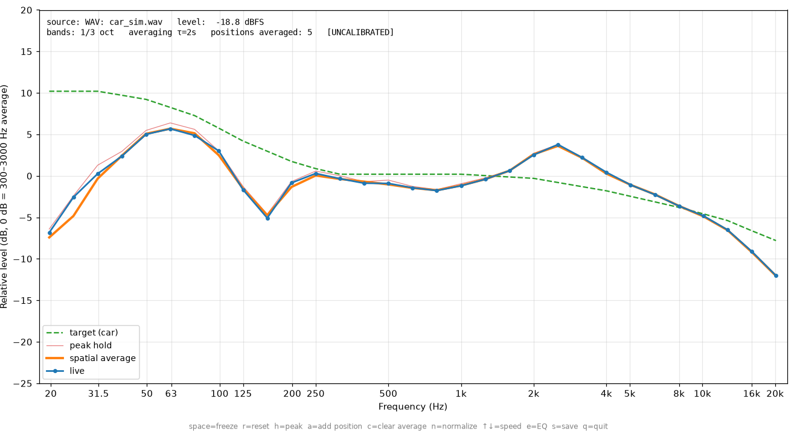
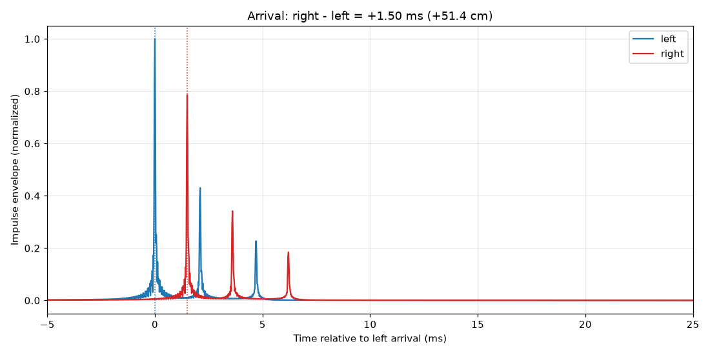
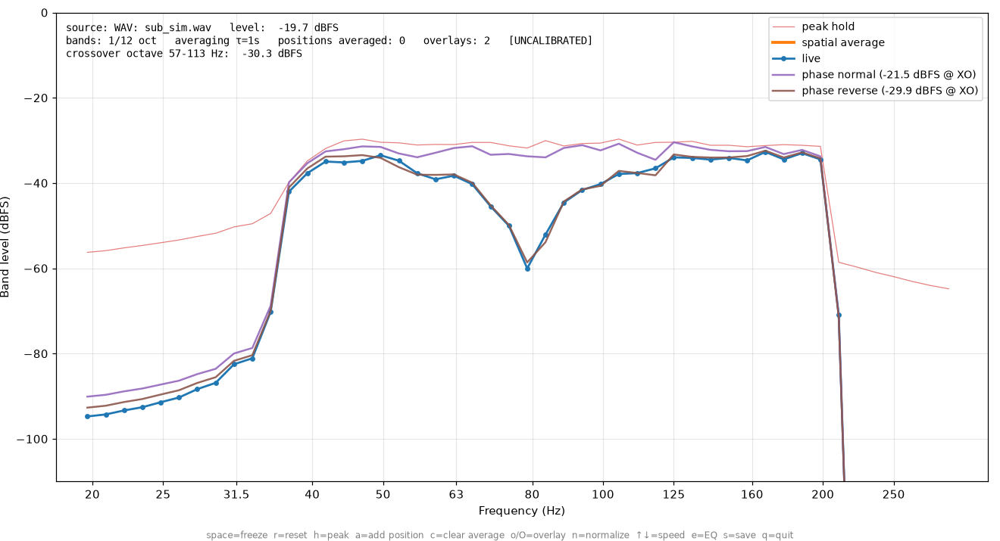
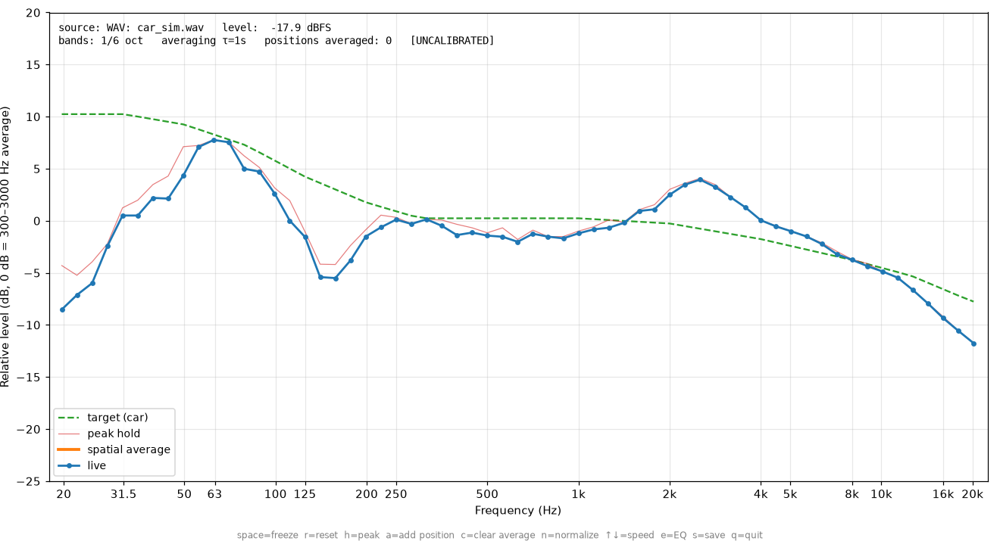

# RTA for tuning car audio

Real-time spectrum analyzer (RTA) and time alignment measurement in Python, built for the
**Dayton Audio iMM-6** microphone and test signals played from an iPhone.

Everything runs through `main.py` and its three commands:

- `generate` (`gen_noise.py`) creates the test signal WAV files to copy to the iPhone.
- `rta` (`rta.py`) captures the microphone, applies the iMM-6 calibration and shows the response in
  1/3-octave bands (configurable) alongside a target curve. Has a subwoofer mode and labeled
  overlays to compare settings.
- `delay` (`delay.py`) measures the left/right arrival time difference and tells you which distances to
  enter in the head unit's time alignment.



*Screenshots use simulated car responses fed through `--wav`, not real measurements.*

## Installation

> Microphone access from WSL is unreliable: run it with **native Windows** Python
> (or directly on macOS/Linux).

Requires [uv](https://docs.astral.sh/uv/). On Linux also: `sudo apt install libportaudio2`
(on Windows and macOS PortAudio ships with `sounddevice`).

```bash
uv sync                          # create .venv and install dependencies
uv run main.py generate --type all  # creates every test signal in signals/
uv run main.py rta --list-devices   # find the microphone's device index
uv run main.py rta --device 1 --cal 7012345.txt
```

Test without a microphone: `uv run main.py rta --wav signals/pink_noise_LR.wav` (should look flat).
Every command accepts `-v` for debug output and `--help` for its options.

## Test signals

| File | Use |
|---|---|
| `pink_noise_LR.wav` | EQ: same pink noise on both channels |
| `pink_noise_L.wav`, `pink_noise_R.wav` | EQ: one side at a time |
| `sub_noise_LR.wav` | Subwoofer phase/distance: pink noise limited to 40–200 Hz |
| `rattle_sweep.wav` | Rattle test: slow 20–120 Hz sine sweep (60 s) |
| `delay_sweeps.wav` | Time alignment: alternating left/right sweeps for `main.py delay` |
| `white_noise_*.wav` | White noise, same layout as pink (rarely needed) |

All files loop seamlessly: play them on repeat.

## Using the microphone with a laptop

- The iMM-6 has a **TRRS** plug (phone-style). It works in a laptop's combined
  headphone+mic jack. If your laptop has separate jacks, use a USB adapter with a TRRS
  input (cheap "headset" USB sound cards work).
- On Windows, disable the microphone's **audio enhancements / noise suppression / AGC**
  (Settings → Sound → microphone → Audio enhancements: off) and set a fixed gain.
  Otherwise Windows reshapes the signal and the measurement is useless.
- Set the gain so the level sits between -40 and -12 dBFS with no CLIPPING warning.

## Laptop only (no phone)

The iMM-6 has a headphone pass-through jack, so the laptop's single combo jack can both record
the microphone and play the test signal into the car:

```
laptop combo jack ── iMM-6 ── pass-through ── AUX cable ── head unit AUX input
```

Add `--play` and pick the output with `--out-device` (usually the laptop's "Headphones"; see
`--list-devices`). The signal is generated on the fly, so no WAV files are needed:

```bash
uv run main.py rta --device 1 --out-device 2 --play pink      # or pink-L, pink-R, sub, white
uv run main.py delay --device 1 --out-device 2 --play --left-cm 95
```

- `--play-level` sets the `rta` signal level (default -18 dBFS RMS). Start with the car's volume low.
- Since the mic is plugged into the laptop, use a **4-pole TRRS extension cable** (CTIA, 1–2 m)
  to hold it at head height with the laptop on the seat.
- If the head unit has no AUX input, pair the laptop over Bluetooth and choose the car as the
  output device (keep the laptop jack as the input, not the car's hands-free microphone).
- Hum or whine with the laptop charging from the car is a ground loop: unplug the charger or
  add a ground loop isolator on the AUX cable.

## Calibration file

Each iMM-6 has its own file matched to its serial number (printed on the microphone). Download
it from the iMM-6 page on daytonaudio.com by entering the serial. Use it with `--cal file.txt`.
If you point the microphone at the roof, use the 90° file if available; if you point it
toward the front of the car, use the 0° file.

## Suggested in-car procedure

Before starting: head unit EQ flat, loudness/bass boost/"sound effects" off, fader and balance
centered. iPhone: Music EQ off, Sound Check off. Prefer cable/USB/CarPlay over Bluetooth.
Engine off, or idling with the fan off. The microphone goes at the driver's head height.
Each step below plays a WAV from the phone; with the laptop only, use `--play` instead.

### 1. Rattle test

Play `rattle_sweep.wav` at a moderate-to-loud level and listen for buzzing door panels, mirrors,
the license plate, etc. Fix them first: they add distortion that no EQ can remove.

### 2. Time alignment (`main.py delay`)

1. Tape-measure the distance from your head to each speaker and enter it in the head unit's
   time alignment (Pioneer units take distances). That alone gets most of the benefit.
2. Play `delay_sweeps.wav` on loop (or add `--play`), put the microphone at your head position
   and run:

   ```bash
   uv run main.py delay --device 1 --left-cm 95   # your tape-measured left distance
   ```

   It records 12 s, finds each sweep's impulse response and prints how much later one side
   arrives, as a distance:

   ```
   The right side arrives 1.50 ms later than the left side (spread ±0.00 ms) -> 51.4 cm farther acoustically.
   Time alignment (distance entry on the head unit):
     left = D,  right = D + 51 cm
     With --left-cm 95: left = 95 cm, right = 146 cm
   ```

3. Apply it and measure again: the difference should be close to 0 ms. If time alignment was
   already on, the measured difference adds to the current settings.



Only relative timing is measured (the phone and laptop clocks aren't linked), which is all the
head unit needs. The clock drift between the two devices is estimated and removed. For the rear
speakers, use the fader to play only the rear pair.

### 3. Subwoofer (`main.py rta --sub`)

Sub mode shows 20–300 Hz in 1/12 octave, absolute dBFS, slow averaging, and the level of the
octave around the crossover (`--xo`, default 80 Hz). Play `sub_noise_LR.wav` (or `--play sub`) with the sub and
the front speakers on:

```bash
uv run main.py rta --device 1 --cal 7012345.txt --sub --xo 80 --labels "phase normal,phase reverse"
```

1. **Phase/polarity:** wait for the curve to settle and press **o** to keep it as an overlay
   ("phase normal"). Switch the sub phase on the head unit, wait, press **o** again. Keep the
   setting with the higher, smoother response around the crossover. The wrong one shows a dip.
2. **Sub distance:** with the better phase, step the sub's distance in the time alignment
   and keep an overlay for each value. Keep the one with the strongest, flattest crossover region.
3. **Level:** go back to full-range `pink_noise_LR.wav` in normal mode and set the sub level
   so the bass matches the target curve.



### 4. EQ

1. Play `pink_noise_LR.wav` on loop (or `--play pink`) at a normal-to-loud listening level.
2. Move the microphone through 4–6 positions around your head (±15 cm) and press **a** at each
   one to add it to the spatial average (orange curve). This avoids correcting peaks/dips that
   only exist at a single point.
3. Press **e** to see the suggested per-band EQ correction and apply it on the head unit's EQ.
   Boosts are limited to +6 dB: a deep, narrow dip is usually an acoustic null that EQ can't fix.

   ```
   Suggested EQ correction (average of 5 positions, limits -12/+6 dB):
        125 Hz   +5.7 dB  ++++++
        157 Hz   +6.0 dB  ++++++
        ...
      2.52 kHz   -4.4 dB  ----
   ```

4. Measure again, compare (**o** overlays help here too) and save with **s** (CSV + PNG in
   `captures/`).
5. Optional: use `pink_noise_L.wav` and `pink_noise_R.wav` to compare each side.

1/6-octave resolution (`--bands 6`) shows more detail:



## Keys (`main.py rta`)

| Key | Action |
|---|---|
| space | freeze / resume |
| r | reset averaging and peak hold |
| h | show/hide peak hold |
| a / c | add position / clear spatial average |
| o / O | keep the live curve as a labeled overlay / remove the last overlay |
| n | normalized (0 dB = 300–3000 Hz average) / absolute dBFS |
| ↑ / ↓ | slower / faster averaging |
| e | print EQ correction |
| s | save CSV + PNG (overlays included) |
| q | quit |

## Useful options

- `--bands 6` (or 12, 24) for more resolution. 3 = 1/3 octave, same as a 31-band EQ.
- `--target flat|car|none|file.txt` target curve. `car` = about +10 dB bass boost and a gentle
  roll-off toward the treble (typical in cars). You can use your own "frequency dB" file.
- `--tau 2` for steadier averaging (pink noise fluctuates; 1–2 s is reasonable).
- `--sub`, `--xo 80`: subwoofer mode and crossover frequency.
- `--labels "a,b,c"`: names for the overlays, in order (otherwise A, B, C...).
- `--play SIGNAL --out-device N`: play the test signal from the laptop (see "Laptop only").
- `main.py delay --seconds 20` for more cycles, `--save-wav` to keep the recording.
